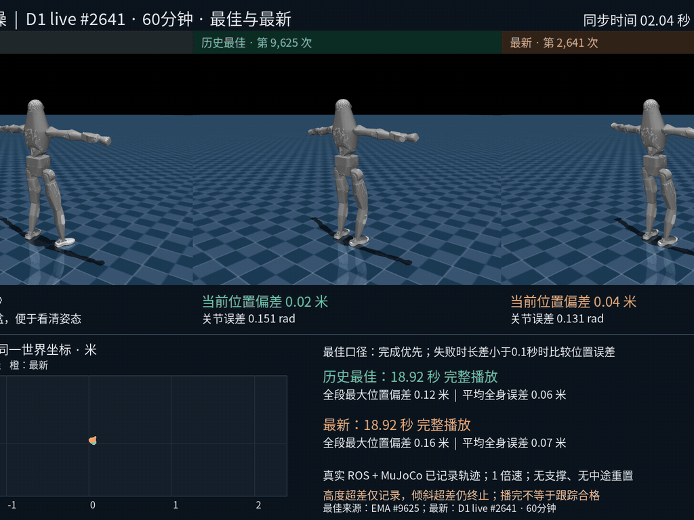
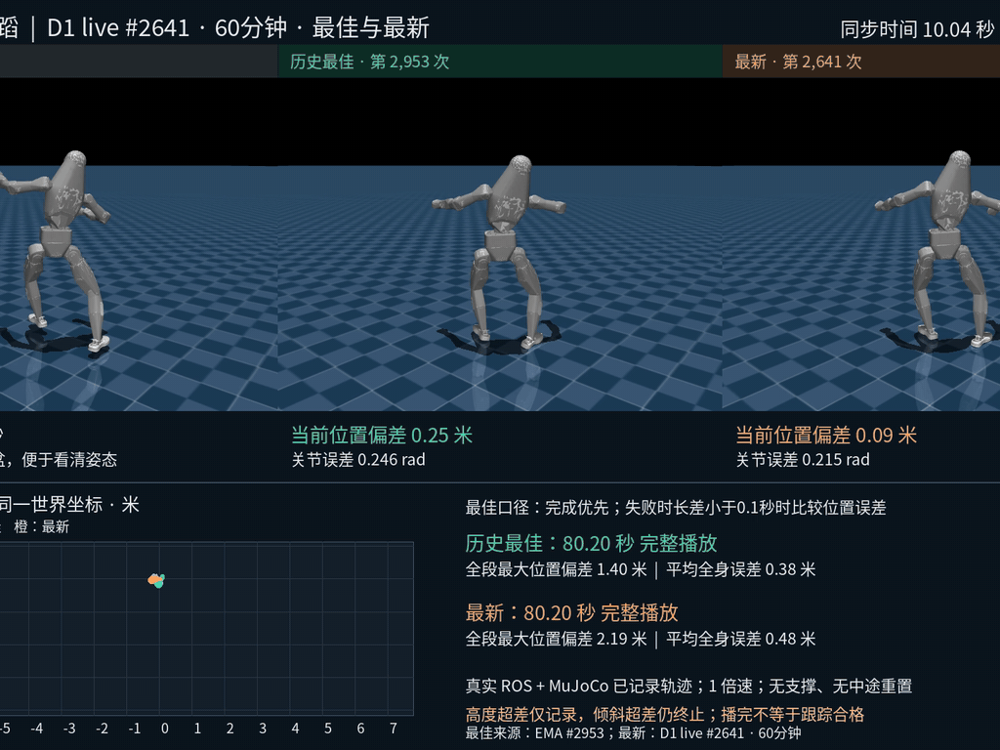
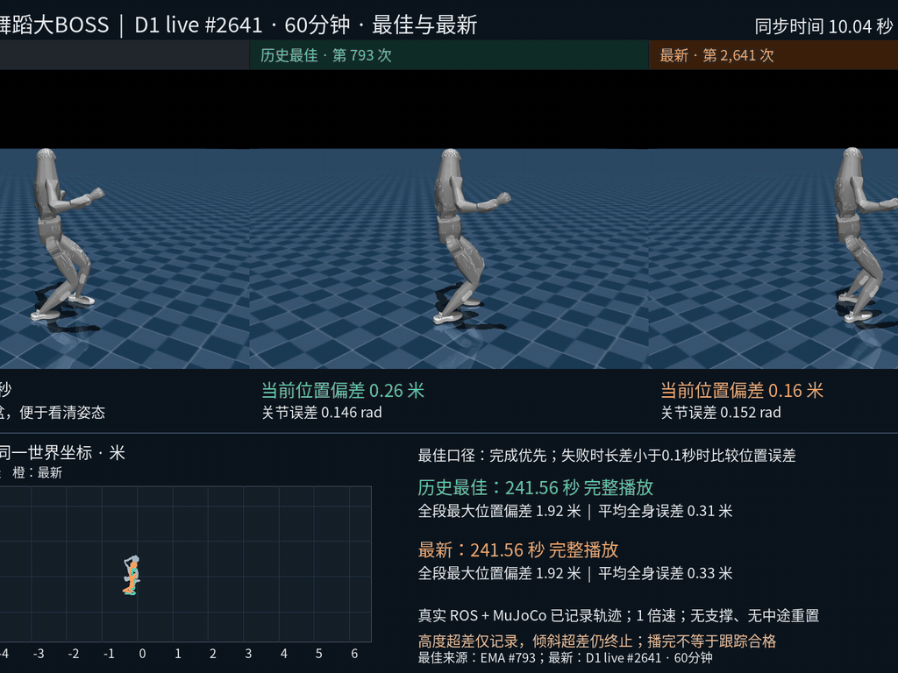

# Dex-SuperMimic

Dex-SuperMimic 让**一个策略**接受不同的参考动作，在 Dex 29 自由度机器人上执行全身跟踪。换参考不换权重：一支舞、一段新动作，只需替换参考特征即可直接跟踪，无需重新训练。

技术路线沿用 SuperMimic 的**学习动力学世界模型 + 可微展开 BPTT 策略优化**，基于 InstantTrack 的 mjlab / MuJoCo Warp 实现；重定向使用内置 Dex v7，回放接入既有 ROS 2 / MuJoCo 链路。

## 演示效果

三个动作的历史最佳与最新策略对比（GIF 截取自 `data/evaluation/videos/*_best_vs_latest.mp4`，各 15 秒；源视频含版权内容，仅保留在本地）：

| GBTC | dance-boy | dance-girl |
| :---: | :---: | :---: |
|  |  |  |

## 仓库内容

本仓库以 **12341 EMA 策略及其控制契约**为整理基准，公开主流程源码、配置、测试、文档和上方三段演示 GIF。权重（checkpoint / ONNX）、编译模型、机器人资产及演示动作数据均未随 Git 发布；BONES-SEED / LAFAN1 训练集也需按 [数据说明](data/README.md) 另行获取。

**当前没有提供完整基线 ZIP 或 Release 附件。** `git clone` 和 GitHub 的 Download ZIP 都只取得仓库跟踪的文件，不能直接运行 12341 基线。所需材料与准备方式见 [发布范围与本地材料](docs/DISTRIBUTION.md)。


```text
BONES-SEED（SOMA Uniform BVH） / LAFAN1（原始 BVH）
    ↓ 内置 Dex v7：骨架校准、足部 XYZ 接触、手掌/肘轴与腕部限位
Dex robot PKL（预览）+ 50 Hz robot NPZ（训练）→ 质量分级 → 有界特征分片
    ↓ 世界模型 + BPTT，参考动作轮换，保留难度记忆
EMA checkpoint → ONNX + 机器人契约 / 编译模型
    ↓ 更换参考特征，无需为每支舞重新训练
原生 MuJoCo / ROS 2 + MuJoCo → 指标与参考 / 历史最佳 / 最新视频
```

## 准备基线材料后回放

以下命令仅适用于已自行取得匹配的 12341 权重、资产和参考动作的工作区。公开仓库不提供这些文件的完整下载包。请先按 [权重说明](checkpoints/12341/README.md)、[资产说明](assets/dex_evt/README.md) 和 [动作说明](data/evaluation/README.md) 准备下列本地文件；没有原始 12341 材料时，可使用后文训练入口训练自己的策略，但不能据此声称复现同一基线。

```text
checkpoints/12341/
  artifacts_manifest.json    # 原始基线文件清单及 SHA-256
  ckpt_012341.pt              # EMA / live actor + 世界模型
  full_state_012341.pt        # 用于恢复训练的完整状态
  bundle/
    policy.onnx              # 已验证的 EMA 策略
    model.mjb                # 已验证的 MuJoCo 3.16.0 编译模型
    contract.json
    export_check.json
assets/dex_evt/               # 完整 XML、网格、URDF、元数据与原始 LICENSE
data/evaluation/             # motions、references、suite.json、download_manifest.json
```

材料齐备后，在仓库根目录安装 Linux 轻量回放依赖并执行校验；这一步不需要 CUDA、PyTorch、mjlab 或 BONES。`check_baseline.py` 需要上述两个原始清单及其列出的全部文件，源码克隆中缺少这些材料时无法通过：

```bash
python3.11 -m venv .venv
source .venv/bin/activate
python -m pip install -e .
export DEX_SUPERMIMIC_ROOT="$PWD"
python scripts/check_baseline.py --sha256
mkdir -p runs/baseline
DEX_EVALUATION_PROFILE=height_diagnostic_v1 dex-sm play --bundle checkpoints/12341/bundle --reference data/evaluation/references/dance_boy.npz --out runs/baseline/dance_boy.json
```

这套入口曾使用维护者本地齐备的基线材料，在未安装 PyTorch / mjlab 的全新 Python 环境验收；该记录不表示公开仓库附带运行材料。网络下载慢时，安装命令可加 `--index-url https://pypi.tuna.tsinghua.edu.cn/simple`。

这会实际运行 CPU MuJoCo 闭环仿真，生成指标 JSON 和记录轨迹 NPZ；不是打开图形窗口。准备相应参考文件后，改用 `gbtc.npz` 或 `dance_girl_original_start.npz` 即可换动作。ROS 回放和比较视频入口见 [部署与评估](docs/DEPLOYMENT.md)。

需要转换新动作或重新导出时，先准备对应的机器人动作、checkpoint 和资产，再安装 [训练/导出环境](docs/SETUP.md)。以下以本地 12341 材料为例，使用其他材料时替换路径：

```bash
dex-sm bundle motion --source data/evaluation/motions/dance_boy.npz --out runs/baseline/dance_boy.reference.npz
dex-sm bundle export --checkpoint checkpoints/12341/ckpt_012341.pt --out runs/reexport_12341/bundle
```

输入为匹配 Dex 模型的机器人 NPZ；支持的人体 BVH 先经过内置 v7 转换，视频还需要独立的人体姿态提取。Robot PKL 不是 SMPL-X 模型。文件准备范围见 [发布范围与本地材料](docs/DISTRIBUTION.md)。

## 数据到训练

当前数据转换入口已切换为 **Dex v7**，支持以下两个数据集：

| 数据集准确名称 | 本包使用的数据 | `--dataset` |
|---|---|---|
| [BONES-SEED: Skeletal Everyday Embodiment Dataset](https://huggingface.co/datasets/bones-studio/seed) | SOMA Uniform BVH | `bones_seed` |
| [Ubisoft La Forge Animation Dataset（LAFAN1）](https://github.com/ubisoft/ubisoft-laforge-animation-dataset) | 官方原始 BVH | `lafan1` |

SOMA 是此处使用的人体骨架表示，不是第三个数据集。v7 从原始 BVH 完整求解，支持骨盆/躯干校准、脚底几何与 XYZ 接触约束、手心方向、J3/J5 时序分配，以及 NASA 人体活动范围与机器人物理限位相交后的 J6/J7 约束。实现、检查边界与迁移步骤见 [v7 转换说明](docs/RETARGET_V7.md)。

旧 GMR 转换记录不能直接用于新 `data build`；请用新的 `processed_v7` 和 `release_v7` 目录重新转换、筛选和构建。历史 12341 权重、演示及统计仍属于旧基线，不代表用 v7 重训后的结果。

[数据说明](data/README.md)规定来源清单、分类、转换和缓存。全部合格 BONES-SEED 数据参与训练；较难的库内片段只作难度探针，GBTC、dance-boy、dance-girl 作为外部开发评测，不进入训练。反复调参使用的外部动作也不应声称是独立测试集。

```bash
# 安装内置 CPU 转换器；先准备 assets/dex_evt 中的机器人资产
python -m pip install -e ".[convert]"
export DEX_SUPERMIMIC_ROOT="$PWD"
dex-sm data convert --dataset bones_seed --manifest data/bones_seed/sources.jsonl --out data/bones_seed/processed_v7 --workers 1
# LAFAN1 单独转换、单独建库，不自动混入 BONES-SEED
dex-sm data convert --dataset lafan1 --manifest data/lafan1/sources.jsonl --out data/lafan1/processed_v7 --workers 1
# 训练环境；默认 CPU 构建特征，不与训练争抢 GPU
dex-sm data build --records data/bones_seed/processed_v7/records --out data/bones_seed/release_v7
# 从头训练基础跟踪器
dex-sm train --config configs/train_fresh.json --data-release data/bones_seed/release_v7 --log_dir runs/base
# 显式增加根位置反馈；取已训练基础策略初始化，重建优化器和 critic
dex-sm train --config configs/train_feedback.json --data-release data/bones_seed/release_v7 --warm_start runs/base/ckpt_NNNNNN.pt --log_dir runs/feedback
```

`NNNNNN` 替换成实际 checkpoint 编号。默认优先 8192 环境；显存不足时再降低环境数或批量。分片容量 60 万帧、150 秒轮换、CPU 预取、固定 GPU 张量存储、每次切换清空 replay 并预热 64 步。训练实时记录资源、分片切换、动作覆盖率和 loss。

12341 来自已有基础策略再训练根位置反馈，并非单次随机初始化直接训练得到。这里提供可迁移的训练入口，不能保证重新随机训练得到逐位相同权重。原基线配置与恢复语义见 [基线](docs/BASELINE.md)。

## 每半小时评估

训练会在初始状态、约每 30 分钟、最终状态保存评估任务。另开 CPU worker 消费队列，实际评估可能因视频渲染排队而延后；任务对应的 checkpoint 会保留。

以下示例要求本地已准备三个参考 NPZ；使用自有动作时，替换 `--reference` 名称与路径。

```bash
python scripts/make_suite.py --reference gbtc=data/evaluation/references/gbtc.npz --reference dance_boy=data/evaluation/references/dance_boy.npz --reference dance_girl=data/evaluation/references/dance_girl_original_start.npz --out data/evaluation/suite.json
dex-sm watch --queue runs/feedback/evaluation_queue --suite data/evaluation/suite.json --history runs/feedback/history --ros-python "$ROS_PYTHON" --ros-setup /opt/ros/humble/setup.bash --domain 226 --render
```

不传 `--ros-python` 时只验证原生 MuJoCo，视频会注明。ROS 评估使用相同 ONNX、参考、PD、初态，并要求两条物理轨迹逐元素一致。每个动作只显示参考、历史最佳、最新；后两者策略相同会标明。评估口径与 ROS 环境见 [部署与评估](docs/DEPLOYMENT.md)。

## 当前能力与限制

历史 12341 仿真记录：GBTC **18.92 秒**、dance-boy **80.20 秒**完成；dance-girl 原始起始动作 **165.58 / 241.56 秒**后终止。三个动作在原生 MuJoCo 与 ROS 回放中轨迹一致。这些是基线历史结果；本次整理的验证记录单列在 [验证报告](docs/VALIDATION.md)。

外部演示使用 `height_diagnostic_v1`：25 cm 高度偏差记录但不单独终止，倾斜超差仍终止。播完不等于精度合格。训练仍使用原终止规则。根位置纠偏使用**仿真真值**；真机还需状态估计、延迟、保护和硬件验证。现有 ROS 为 50 Hz 锁步联调，不是硬实时验收。

C、D 等探索曾用于检验补充动作、困难片段采样和续训保持能力；暴露出长动作稳定性不一致、续训可能退化等问题，未替代 12341 基线。本仓库不收录这些试验的配置与编排脚本。

## 来源

- [InstantTrack](https://github.com/Huy-Quang-Dao/instantTrack)：核心网络、世界模型、BPTT 与 GPU 环境，MIT；保留 `instanttrack` 命名空间及许可证。
- [mjlab](https://github.com/mujocolab/mjlab)：仿真基础设施，安装固定提交。
- [Dex-Video2Robot](https://github.com/luckylhf/Dex-Video2Robot)：历史转换链及机器人资产来源。
- [NVIDIA SOMA Retargeter](https://github.com/NVIDIA/soma-retargeter) 与 [GMR](https://github.com/YanjieZe/GMR)：v7 的人体校准、接触处理及 LAFAN1→G1 坐标参考；v7 是面向 Dex 的本地实现，不是官方 Dex 转换器。
- [BONES-SEED](https://huggingface.co/datasets/bones-studio/seed) 与 [LAFAN1](https://github.com/ubisoft/ubisoft-laforge-animation-dataset)：人体动作来源，使用者须遵守各自许可。

详细来源与许可边界见 [THIRD_PARTY.md](THIRD_PARTY.md)。
